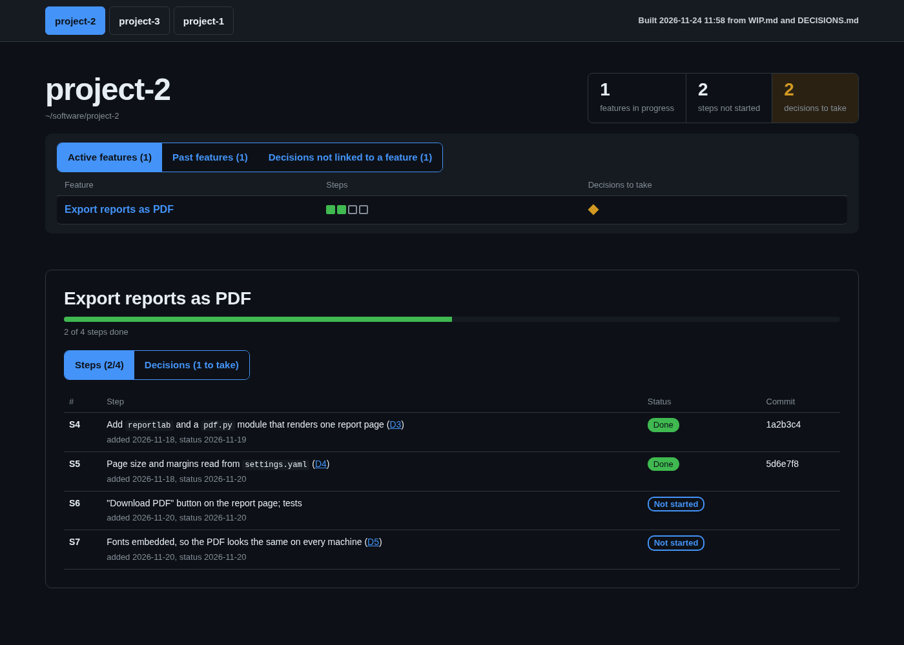

# Working with Claude Code: agreement, project memory and status page

This repository holds my way of working with Claude Code that follows good practices: Claude plans before it changes anything, asks you to choose when there is a real choice, works in small steps you review, and writes every decision and step into the project, so each session picks up where the last one stopped.

Two tools set it up:

- **Set up a project** (`setup_project.py`): gives a project the working agreement (`CLAUDE.md`) and the three memory files Claude keeps there between sessions (`WIP.md`, `DECISIONS.md` and `MINIMAP.md`).
- **Work status page** (`setup_work.py`): one private web page with the features, steps and decisions of all your projects, updated with the `/work` command.

[`templates/CLAUDE.template.md`](templates/CLAUDE.template.md) contains my rules for working with Claude. Each project gets it as its `CLAUDE.md`. Read it, and change what does not suit you before using it.

## Requirements

- **Python 3.8 or later**: for the two scripts and the page.
- **Claude Code**: for the working agreement and the `/work` command.
- **Connection to your claude.ai account**: Claude Code, signed in with your claude.ai account, gets the artifacts tools it needs to create and update private pages. To check, run `/mcp` in a session and see if `claude-artifacts` appears in the list of MCP servers.

## Installation

Clone this repository and go into its folder:
```
git clone https://github.com/albavilanova/claude-setup.git
cd claude-setup
```

## Set up a project

### What it does

A project gets the working agreement and its memory files, so that every Claude Code session there works the same way and picks up where the last one stopped:

- `CLAUDE.md`: how Claude works with you in this project.
- `WIP.md`: the features in progress and their steps.
- `DECISIONS.md`: every decision you make, with its question and options.
- `MINIMAP.md`: what the project is, its traps, your rules, and the decisions not settled.

The script creates the four files from `templates/`. For each file the project already has, it asks whether to overwrite it, and if so keeps the old version as `<file>.bak` (`.bak2`, `.bak3`… if taken). It also adds the four files, and those copies, to the project's `.gitignore`, as they are your notes rather than the project's code.

### How to set it up

To set up the working files, run:
```
python3 setup_project.py [<project folder>] [--name NAME]
```

Where:
- `<project folder>`: the project to set up; it must exist. If not given, the script asks for it, suggesting the current folder.
- `--name`: the project's name, written in the titles of `CLAUDE.md`, `WIP.md` and `MINIMAP.md`. If not given, the script asks for it, suggesting the folder's name.

**Example**

If the repository was cloned into `~/software/claude-setup` and the project where you want to apply the rules is in `~/software/project-1`:
```
$ python3 setup_project.py ~/software/project-1 --name "Project 1"

Project: /home/me/software/project-1
  Created: CLAUDE.md, WIP.md, DECISIONS.md, MINIMAP.md
  Added to .gitignore: CLAUDE.md, MINIMAP.md, WIP.md, DECISIONS.md, CLAUDE.md.bak*, MINIMAP.md.bak*, WIP.md.bak*, DECISIONS.md.bak*

  To do: CLAUDE.md has <...> placeholders for what is specific to this project: ...
```

Once the files are in your project, start Claude Code in the project and ask it to *"read this project and fill in the `<...>` placeholders of CLAUDE.md; show me Before and After"*, so that it knows how to test your project and what to ask you before changing anything. Replace the example rows of the other three files (D1, S1, gotcha 1) with real ones, or delete them.

## Work status page

### What it does

Run `/work` in a Claude Code chat to build and open a page with the status of your projects. The page is private, on claude.ai, and keeps the same link each time.



The page has one tab per project listed in your `config.json` (see below). Each tab shows the project's features, active or past, and the decisions to take that belong to no feature. For each feature, it shows its steps (done or not) and its decisions in four groups (to take, taken but not yet applied, applied, replaced). On a decision, "Answer" or "Change" lets you pick an option or write your own, and "Copy answer" copies a line to paste into any chat.

Every time you run `/work`, Claude first wraps up the current chat, updating the project's `WIP.md`, `DECISIONS.md` and `MINIMAP.md`, and then builds and publishes the page.

### How to set it up

To set up the Work status page, run:
```
python3 setup_work.py
```

`setup_work.py` installs or updates the command in `~/.claude/skills/work/` (a Claude Code skill: a folder with a `SKILL.md`). It asks before it overwrites a file you changed there, and keeps the old one as `.bak` (`.bak2`, `.bak3`… if taken). It also tells the skill where your `config.json` is (see below).

It reads `configurations/config.json`, which you create from `configurations/config.example.json`, and which is ignored by git:
```json
{
  "projects": {
    "~/software": ["project-1", "project-2"],
    "~/work": ["project-3"]
  },
  "order": ["project-2", "project-3", "project-1"]
}
```

`"projects"` names, for each folder where projects live, the projects to show; a project can be in the folder itself or one or two levels below it (`~/work/clients/project-3` is listed as `project-3`). `"order"` gives the order of the tabs, and must name every project. A project name can be listed only once, so two projects in different folders need different folder names. Without `config.json`, with a project missing from `"order"`, or with a name listed twice, the script stops and installs nothing.

The page changes only when you run `/work`, not when you run `setup_work.py`. After you change `config.json`, `setup_work.py` compares it with the one the page was last built from (saved by `/work` as `configurations/last_build_config.json`, ignored by git) and tells you to run `/work` if a folder's projects or the order changed.

**Example**

With the `config.json` above:
```
$ python3 setup_work.py
/work skill in /home/me/.claude/skills/work
  Installed: SKILL.md, build_page.py, style.css, script.js

Tabs, in order (/home/me/software/claude-setup/configurations/config.json):
  project-2, project-3, project-1

No record of the page's last build yet: /work writes it when it builds the page.

In Claude Code, type /work to wrap up and publish the Work status page.
```

Then start a new Claude Code session and type `/`: `work` should be listed. Run `/work`: the first time, Claude creates the page and gives its link.

## Structure of this repository

| Path | What it is |
|---|---|
| `templates/` | `CLAUDE.template.md`, the working agreement (roles, planning, how Claude asks you to decide, how it proposes changes, code style, and the three memory files with their formats and the wrapup), with `<...>` placeholders for what is specific to a project; and empty `WIP.template.md`, `DECISIONS.template.md` and `MINIMAP.template.md`, with their headings, table headers and one example row. |
| `setup_project.py` | Sets up a project. |
| `setup_work.py` | Sets up the Work status page. |
| `configurations/` | `config.example.json`, an example of `config.json`, which lists the projects shown on the Work status page and their order. Your own `config.json` goes next to it, with `last_build_config.json`, the config of the last page `/work` built; both are ignored by git. |
| `skills/work/` | The `/work` skill: `SKILL.md` (what Claude does on `/work`), `build_page.py` (builds the page), and `style.css` and `script.js` (its look and behaviour, written into the page). |
| `docs/` | The screenshot used in this README. |